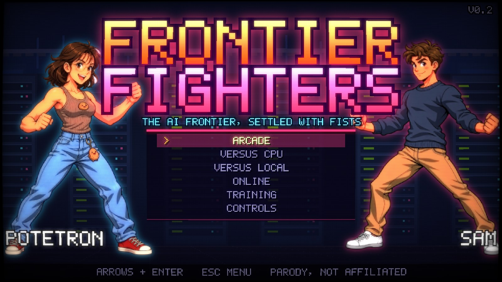

# Frontier Fighters

**Play now: [bhavsarpratik.github.io/frontier-fighters](https://bhavsarpratik.github.io/frontier-fighters/)**

[](https://bhavsarpratik.github.io/frontier-fighters/)

A 2D arcade fighting game where the AI frontier settles things with fists. It runs in the
browser and online play is peer-to-peer, so there's no game server.

> **Parody.** Not affiliated with or endorsed by anyone depicted. Names are bent, looks are
> pixel caricatures, and every quote is made up.

| Fighter | Archetype | Specials (facing right) |
|---|---|---|
| Andrej Karpathink | All-rounder | QCF+P Backprop Blast · DP+P Gradient Ascent · QCB+K Zero to Hero · Super: FROM SCRATCH |
| Thibault Codeaux | Rushdown | QCF+K Cloud Dash · DP+P PR Swarm · QCB+P Rate-Limit Reset (counter) · Super: MERGE CONFLICT |
| Potetron | Summoner | QCF+P Reset Horde · QCB+P Spud Toss (overhead) · DP+P Hotfix · Super: FOUR DAY BUILD |
| Alexandr Wangle | Zoner / trapper | QCF+P Bounding Box (freeze) · QCB+P Label Army (low) · DP+P Scale Up · Super: GROUND TRUTH |
| Sam Altmind | Zoner | QCF+P AGI Orb · QCB+K Pivot (teleport) · DP+P Hype Cycle · Passive: *Fired? Rehired.* · Super: SUPERINTELLIGENCE |
| Jensen "Jacket" Hwang | Heavy / armor | QCF+P Tensor Core Charge · DP+P Jacket Spin · QCB+K GPU Drop · Super: THE MORE YOU BUY |
| Mark Zuckerbot | Grappler | QCB+P Jiu-Jitsu Takedown (command grab) · QCF+K Metaverse Warp · DP+P Pivot Elbow · Super: META LOCK |
| Elan Tusk | Charge | [back]fwd+P Rocket Dash · [down]up+K Starship Flip · QCB+K Hardcore Mode · Super: FULL SEND |

The super is QCF QCF + punch with 3 bars of meter. **Simple mode:** the Special button plus a
direction does any special, and Special + up does the super. Specials done with two buttons
are EX versions (they cost 1 bar).

## Play

```bash
npm run dev
```

Then open http://localhost:5173. Nothing needs installing; it's plain Node 22.

| | One player | Two players on one keyboard |
|---|---|---|
| Move (W jump, S crouch) | W A S D | P1 W A S D · P2 arrows |
| Punch | J | P1 F · P2 O |
| Kick | K | P1 G · P2 L |
| Special | L (or Space) | P1 H · P2 . |
| Heavy punch / kick | U / I | P1 R / T · P2 P / ; |

Other keys:
- **Throw:** punch + kick together (J + K)
- **Super:** once per round, when the meter is full: L + W, or QCF QCF + J
- **Block:** hold back (hold down-back to block lows)
- **Gamepad:** supported
- **Mute:** M (remembered between visits), or add `?mute` to the URL
- **CRT shader:** F8
- **Hitboxes:** F1 during a match
- **Training mode:** F2 pause, F3 step one frame, F4 change the dummy's behaviour, F5 reset

## Online

1. One player picks **ONLINE → CREATE ROOM** and sends the code or link to the other player.
2. The other player enters the code, or just opens the link.
3. Public Nostr relays introduce the two browsers, and from then on they talk directly over
   WebRTC.

Input travels on an unordered channel that never retransmits. A GGPO-style rollback session
predicts the opponent's input and corrects it when the real input arrives, so the game stays
responsive under lag.

Connection options:
- **MQTT:** a backup way for the browsers to find each other.
- **Manual mode:** copy-paste the connection offer and answer; no third party at all.
- **Same-computer test:** two tabs talking to each other.
- **Your own TURN server:** for networks that block direct connections.

Some networks (strict NAT, some office Wi-Fi and mobile carriers) block direct connections.
Without a TURN server those pairs can't connect, and the lobby says so.

**Why not do what the browser NFS Underground 2 port does?** That port relays the original
game's LAN packets through its own WebSocket server. That works, but someone has to run and
pay for the server.

## Build and deploy

```bash
npm run build
```

This writes two outputs:
- `dist/`: a static site, ready for GitHub Pages.
- `dist-single/index.html`: one self-contained file you can open straight from disk.

About 62 KB gzipped (93 KB for the single file). The only online dependency is Trystero,
loaded from esm.sh when you open the online lobby.

## Tests

```bash
npm test
```

24 tests using Node's built-in test runner:
- Determinism across all 64 matchups.
- Motion-input parsing.
- Hit, block, throw and tech rules.
- Damage scaling and round flow.
- Every special and super coming out from its inputs.
- Rollback peers staying in sync over a simulated link with 30–150 ms latency, jitter and
  10–15% packet loss. Each peer's checksums are compared against an offline replay.

Browser checks, run through headless Chrome (`tools/cdp.mjs`):
- `netpair.html?via=p2p` plays a CPU-vs-CPU online match between two iframes over real
  WebRTC.
- `?demo=1,5,2` starts a CPU-vs-CPU match (this is also the title-screen attract mode).

## Tools

- `gym.html`: the Box Gym. Scrub any move frame by frame, drag or resize its hitbox, and export
  the result as JSON.
- `sprites.html`: a sprite sheet of every fighter in key poses.

## How it's built

```
src/sim      deterministic integer simulation (1 px = 256 units), step(state, p1, p2)
src/content  fighters, moves, frame data, stages: plain data
src/render   pixel rasterizer + paper-doll rig, stages, effects, HUD, WebGL2/Canvas2D output
src/net      Transport interface, rollback session, Trystero/manual WebRTC, BroadcastChannel
src/ai       CPU opponent and training dummy
src/ui       screens: title, select, stage, VS, match, results, lobby
tools        zero-dependency dev server and build (Node's built-in TypeScript stripping)
```

All the art and sound is generated in code; there are no image or audio files. Fighters are
vector body parts, posed with keyframed joint angles and rasterized into outlined,
cel-shaded pixel sprites. Music and sound effects are synthesized with WebAudio, and the
announcer uses the browser's speech synthesis.
